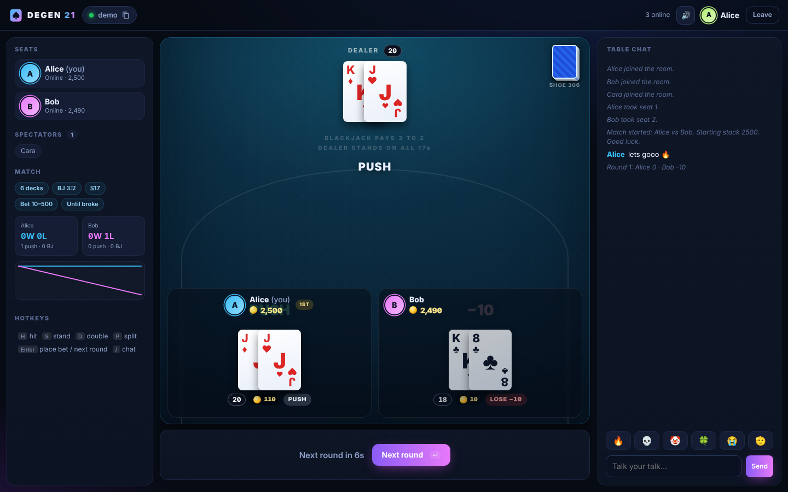

# DEGEN 21 — 1v1 online blackjack

Two players sit at a table, everybody else spectates. No accounts: you type a **name** and the **master password** and you're in.
Live chat, animated cards and chips, synthesized sounds, hotkeys, mobile friendly.



## How a match works

1. Everyone enters name + master password (+ optional room code, default `main`). Share `?room=yourroom` links for separate tables.
2. Two people **take a seat**. Everyone else is a spectator and watches live.
3. Seated players set the rules (starting balance, min/max bet, decks, blackjack payout 3:2 / 6:5 / 1:1, dealer soft-17, round limit, bet and action timers), then both hit **Ready**. Changing a setting un-readies everyone.
4. Each round both players bet, then act in turn (who acts first alternates) against the dealer: **hit, stand, double, split** (up to 4 hands, split aces get one card). Dealer peeks for blackjack.
5. The match ends when someone can't cover the minimum bet, the round limit is hit (highest stack wins), or someone forfeits/disconnects. Then **Back to lobby** for a rematch, or a spectator takes the empty seat.

Hotkeys: `H` hit · `S` stand · `D` double · `P` split · `Enter` place bet / next round · `/` chat.
Cards are shuffled with `crypto.randomInt`; the dealer's hole card never leaves the server until it's revealed.

## Hosting a table

The first person in a room is its **host**. The host picks the game mode and rules, then presses **Open the table**. Only then can players choose where to sit, around a curved blackjack-table layout with as many seats as the mode allows. Only the host can change settings. If the host is gone for 2+ minutes, the next person to act becomes host.

## Game modes

Pick a mode in the lobby once seated (any seated player can change it; changing a setting un-readies everyone).

| Mode | Players | Rules |
|---|---|---|
| Duel | 2 | Classic 1v1 against the dealer, richest stack wins |
| Classic | 2–6 | Everyone plays the dealer, ranking by final stack |
| Showdown | 2–6 | No dealer: best hand takes the pot. Natural blackjack beats 21, ties split, busts lose. Poker-style side pots, nobody loses more than their stake, zero-sum |
| Tournament | 3–6 | Classic vs the dealer with bet limits ×1.5 every N rounds (blinds). Bust out when you can't cover the minimum bet; last one standing wins |

**Blitz** is a toggle that works with every mode: 8s to bet, 8s to act, short intermissions.

## Rooms

A room is the `?room=` name in the URL. At most **10 rooms** exist at once (`MAX_ROOMS`); a room with no activity for **60 minutes** is deleted (`ROOM_TTL_MINUTES`). Trying to open an 11th room returns a "rooms full" message until one expires. Existing rooms are never affected by the cap.

## Run locally

```bash
npm start                 # http://localhost:3000, dev password "degen" if SITE_PASSWORD is unset
SITE_PASSWORD=hunter2 npm start
npm test                  # engine tests + full simulated match (memory and fake-Upstash stores)
```
Zero runtime dependencies. Node 20+.

## Environment variables

| Name | Required | What |
|---|---|---|
| `SITE_PASSWORD` | **yes** | The master password. Changing it logs everyone out. |
| `AUTH_SECRET` | recommended | Extra secret for signing login tokens. |
| `UPSTASH_REDIS_REST_URL` / `UPSTASH_REDIS_REST_TOKEN` | Vercel only | Shared game state (also accepts `KV_REST_API_URL` / `KV_REST_API_TOKEN`). |
| `PORT` | no | Default `3000`. |
| `POLL_MS` | no | Redis polling interval for live updates, default `700`. |

## Deploy: Docker / Coolify (recommended, lowest latency)

State lives in memory in a single process, pushes are instant over Server-Sent Events.

**Coolify**
1. New Resource → your Git repo (`aljaz-h/1v1-blackjack`) → **Build Pack: Dockerfile**.
2. Ports Exposes: `3000`. Health check path: `/healthz`.
3. Environment variables: `SITE_PASSWORD`, `AUTH_SECRET`.
4. Attach a domain and deploy. Keep it to **one replica** (state is in-process). Restarting the container resets live tables.

**Plain Docker**
```bash
docker build -t degen21 .
docker run -d -p 3000:3000 -e SITE_PASSWORD=hunter2 -e AUTH_SECRET=$(openssl rand -hex 24) degen21
# or: SITE_PASSWORD=hunter2 docker compose up -d
```

## Deploy: Vercel

Serverless functions have no shared memory, so game state goes to **Upstash Redis** and live updates use a streaming function that polls it.

1. Import the repo in Vercel (framework preset: *Other*; no build command).
2. Add the **Upstash Redis** integration (Storage / Marketplace). It injects `UPSTASH_REDIS_REST_URL` and `UPSTASH_REDIS_REST_TOKEN` (or the `KV_REST_API_*` pair).
3. Set `SITE_PASSWORD` and `AUTH_SECRET`, deploy.

Notes: the stream function (`api/stream.js`, `maxDuration` 300s) reconnects automatically every few minutes. Free tiers (Vercel Hobby, Upstash free) will limit how many hours you can play; for heavy use run it on Docker/Coolify. If Redis variables are missing on Vercel the site tells you instead of silently splitting state across instances.

## Layout

```
lib/engine.js      pure game state machine (no I/O) — all rules + timers
lib/store.js       memory store + Upstash REST store (compare-and-set writes)
lib/handlers.js    login / act / state / SSE stream, shared by both runtimes
lib/auth.js        master password check + signed tokens
server/main.js     standalone HTTP server (Docker, local)
api/*.js           Vercel function wrappers around the same handlers
public/            the whole UI (vanilla JS, no build step)
test/              engine unit tests, end-to-end bot match, fake Upstash
```

Font: [Geist](https://vercel.com/font) (SIL OFL, self-hosted in `public/fonts/`).
Avatars: players pick a color and icon (click your name in the header, or "Avatar" in the lobby); stored in the room and remembered in the browser.

Characters: [DiceBear](https://www.dicebear.com) (MIT) styles Lorelei, Open Peeps, Pixel Art (CC0) and Bottts (free for commercial use), pre-rendered to `public/avatars/` (see `public/avatars/LICENSES.txt`; regenerate with `node scripts/build-avatars.js`).

Icons: [Iconify](https://iconify.design) sets Lucide (ISC), Material Line Icons and SVG Spinners (MIT), baked into `public/icons.js` (see `public/ICON-LICENSES.txt`; regenerate with `node scripts/build-icons.js`).

Play money only. Gamble responsibly, even if it's fake chips.
