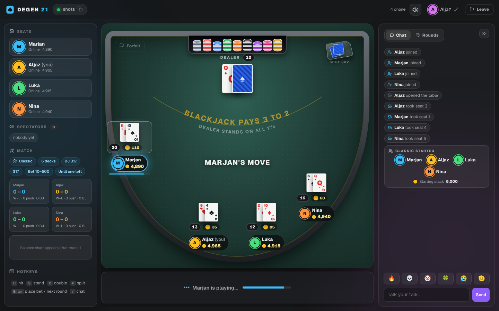
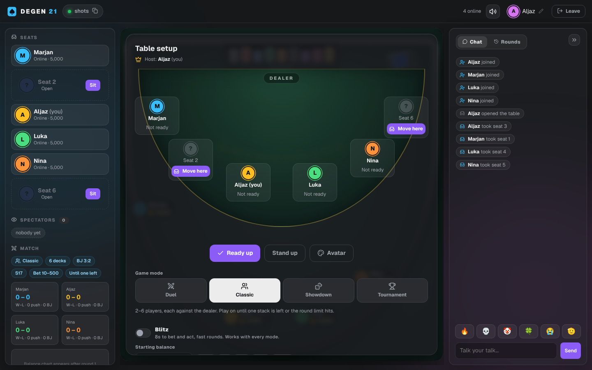
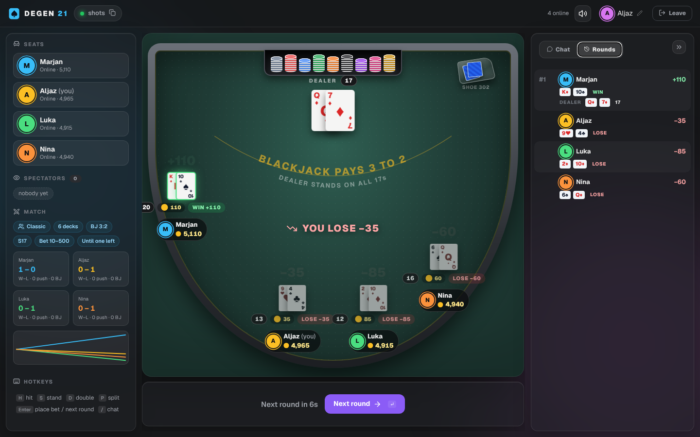
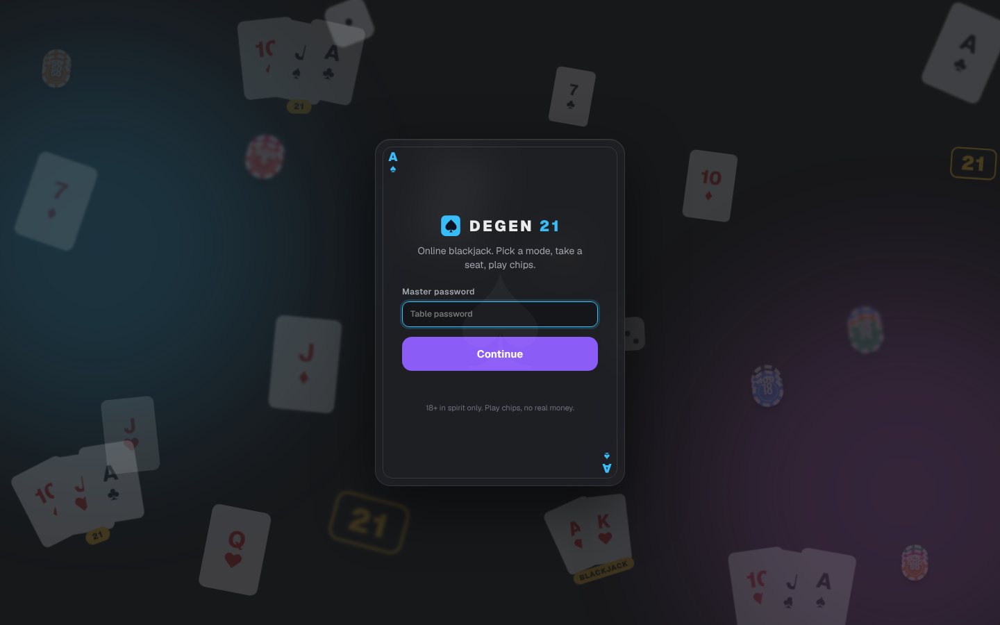
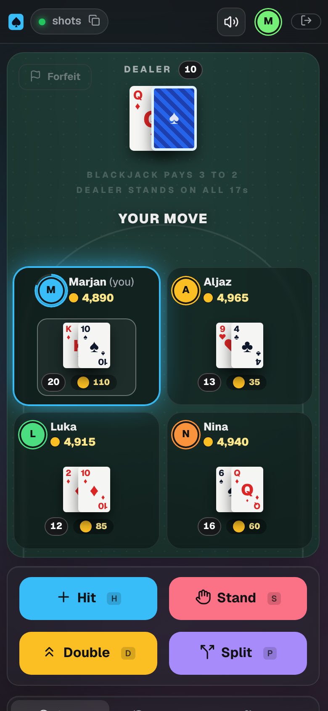

<div align="center">

# ♠ DEGEN 21

**Multiplayer blackjack in your browser. No accounts, no downloads, just a password and a seat.**




</div>

## ✨ Highlights

- 🪑 **Real table feel**: curved felt, arc seating, chip rack, shoe, flying chips and card flips.
- 🎲 **Four modes**: Duel, Classic, Showdown and Tournament, plus a **Blitz** timer toggle.
- 👑 **Host-run rooms**: the first in sets the rules, opens the table, everyone picks a seat, and the host can pause the match.
- 🔐 **Zero accounts**: one master password, a display name and a room code.
- 💬 **Chat, emotes, round history** and a live balance chart.
- 🔊 **Soft synthesized sounds**, keyboard hotkeys, mobile friendly.
- 🧩 **Zero dependencies**: plain Node server, vanilla JS front end, live updates over SSE.

<table>
  <tr>
    <td width="50%" align="center"><br><sub><b>Host sets the table</b>, everyone picks a seat</sub></td>
    <td width="50%" align="center"><br><sub><b>Round results</b> and live history</sub></td>
  </tr>
  <tr>
    <td width="50%" align="center" valign="middle"><br><sub><b>One password</b>, no accounts</sub></td>
    <td width="50%" align="center" valign="middle"><br><sub><b>Plays great on phones</b></sub></td>
  </tr>
</table>

## 🃏 Game modes

| Mode | Players | Goal |
|---|---|---|
| **Duel** | 2 | Two players each play the dealer. Last one with chips wins. |
| **Classic** | 2-6 | Everyone plays the dealer until one stack is left or the round limit hits. |
| **Showdown** | 2-6 | No dealer. Best hand takes the pot, with side pots for unequal bets. |
| **Tournament** | 3-6 | Bet limits rise each round, run out of chips and you are out. |

Blitz adds an 8 second clock to every bet and move. Rooms hold up to 6 seats plus spectators, the server keeps at most 10 rooms, and idle rooms expire after an hour.

## 🚀 Quick start

```bash
SITE_PASSWORD=hunter2 npm start      # http://localhost:3000
```

Open it, enter the password, pick a name and a room, share the link (`/?room=name`) with friends.

## 🌐 Deploy

**Docker / Coolify** (recommended, instant updates, state in memory, run a single replica)

```bash
docker build -t degen21 .
docker run -d -p 3000:3000 -e SITE_PASSWORD=hunter2 -e AUTH_SECRET=$(openssl rand -hex 24) degen21
```

On Coolify choose the **Dockerfile** build pack, expose port `3000`, health check `/healthz`.

**Vercel** import the repo (preset *Other*), add the **Upstash Redis** integration, set `SITE_PASSWORD` and `AUTH_SECRET`. Game state lives in Redis, so free tiers limit long sessions.

| Variable | Required | Purpose |
|---|---|---|
| `SITE_PASSWORD` | yes | Master password (changing it logs everyone out). |
| `AUTH_SECRET` | recommended | Signs login tokens. |
| `UPSTASH_REDIS_REST_URL` / `_TOKEN` | Vercel | Shared game state (`KV_REST_API_*` also works). |
| `PORT` | no | Defaults to `3000`. |

## 🧪 Development

```bash
npm run dev    # watch mode
npm test       # engine + store unit tests and full end-to-end games (memory and Redis)
```

The game is a pure state machine in `lib/engine.js`, shared by the Docker server (`server/`) and the Vercel functions (`api/`). The front end lives in `public/`.

---

<div align="center">
<sub>Play money only. 18+ in spirit. Fonts: Geist · Avatars: DiceBear · Icons: Iconify.</sub>
</div>
